# SecureLife AI: Architecture

Pradumn Kumar Mishra · mishrapradumn2014@gmail.com

## Why this exists

SecureLife's sales team qualifies every lead by hand. An agent chats with the prospect, copies answers into a spreadsheet, waits for policy PDFs by email, and then an analyst reads those PDFs and writes a summary for a senior broker. That loop takes two to three days per lead, which is long enough to lose fast-moving prospects to competitors, and nobody has a single view of where each lead stands.

The goal of this build is to shrink that loop to minutes without taking the broker out of it. Prospects talk to a chat assistant that knows which questions matter for their type of insurance. Brokers see every lead on a pipeline board and decide when to qualify, extract and analyse, with AI doing the reading and the first draft of the thinking. Every AI output is checked by plain code before anything is stored or shown.

This is an MVP built in a day, so I have been explicit throughout about what I left out and what production would need.

## 1. System architecture

There are four moving parts.

**The prospect chat** (`frontend-prospect`) is a single public page. It streams the assistant's replies token by token and, once the assistant has invited it, shows an upload box for the prospect's current policy. It deliberately contains no CRM vocabulary; a prospect should never see words like "pipeline" or "qualification score".

**The broker dashboard** (`frontend-broker`) is the CRM. The home page is the pipeline board, with one tab per stage. Each lead has a detail page laid out in the order a broker works: the pipeline stepper with the next step, qualification, the full conversation, documents, and the analysis.

**The backend** (FastAPI) holds all the logic. I kept it in strict layers: routers only translate HTTP, services hold the business rules, repositories hold the SQL, and the five AI agents live in their own package. Agents never touch the database, which keeps them testable with a fake client.

**Groq** runs the language models. All five agents call it through the OpenAI-compatible endpoint.

Data lives in a single SQLite file, and uploaded PDFs sit on local disk next to it.

### How a lead flows through the system

1. A prospect opens the chat. The backend creates a lead row straight away, so nothing they say is ever lost, even if they leave halfway.
2. Each message goes to the **chat agent**, which streams a reply. As soon as the reply finishes, a background job runs the **chat extractor agent** over that turn and records any facts the prospect gave (name, contact, insurance type, vehicle, and so on).
3. Once the lead has a name and an email or phone number, it appears under **New leads** on the broker dashboard. Before that it is invisible, because a lead with no way to contact them is not actionable.
4. The broker clicks **Run qualification agent**. It reads the whole conversation and returns a verdict with evidence. The lead moves to **In progress**.
5. A policy document arrives, either from the prospect in the chat or uploaded by the broker. The lead moves to **Documents pending review**, unless the verdict was "not qualified", in which case it waits in In progress for the broker to close it.
6. The broker runs the **document extractor agent** on each PDF. Every value it cites is checked against the PDF's own text before it is stored. Then the broker runs the **analysis agent**, which produces coverage gaps, savings, risk flags and a recommended action from the verified facts. The lead moves to **Completed analyses**.
7. The broker closes the lead with a reason: purchased, disqualified or other, plus a note.

The broker triggers every step after the chat on purpose. It keeps token spend under the broker's control, and no lead ever lands in a stage the broker didn't choose.

## 2. Tech stack and why

| Layer | Choice | Why, and what I traded off |
|---|---|---|
| Backend | Python 3.12, FastAPI, Pydantic v2, SQLAlchemy 2 (async), uv | Python is where the AI and PDF tooling is. FastAPI gives typed request handling and an OpenAPI spec for free, which the broker UI uses to generate its API client. Async matters because nearly every request waits on a model call. uv makes install a single command. |
| Database | SQLite with write-ahead logging and foreign keys enforced | Zero setup. The trade-off is single-writer concurrency, fine for a demo and not for a 45-person team. Moving to Postgres is a connection-string change plus `jsonb` columns. |
| File storage | Local disk | Same reasoning. Production would use S3 or Supabase Storage and store object keys instead of paths. |
| PDF handling | PyMuPDF | Fast, reliable text extraction with page boundaries, and it lets me reject encrypted, corrupt or oversized files before a model ever sees them. No OCR, so scanned pages come back empty (covered in section 5). |
| LLM provider | Groq through the official `openai` async SDK | Groq is fast enough that streamed chat feels instant, the free tier was enough to build on, and the OpenAI-compatible API means I get a mature SDK with retries and typed errors. Any other OpenAI-compatible provider is a config change. The cost is free-tier quotas, which shaped a lot of the AI design (section 4). |
| Frontends | React 19, Vite, Tailwind v4, two separate apps | Two apps because prospects and brokers have nothing in common: different audiences, different auth needs later, different deploy targets. The broker app uses React Router, TanStack Query for polling and caching, and a client generated from the backend's OpenAPI spec so contract drift fails at compile time. The prospect app is a single page with a tiny hand-written client to keep it small. |
| Chat transport | Server-sent events over POST | Tokens only flow one way, so SSE is the simplest fit. WebSockets would add a reconnect protocol which is not needed at this stage. |
| Background work | `asyncio.create_task` with its own database session | Extraction can take 10 to 30 seconds. FastAPI's `BackgroundTasks` would reuse the request's session after it closes. In production , we can use A real queue (Celery, RQ), but for this MVP a startup current setting is enough. |

Things I chose not to use: LangChain or any agent framework, because my agents are single calls wrapped in deterministic code and a framework would hide exactly the parts I want visible; A vector database, because a policy document fits in one prompt; and authentication, which is the first thing production needs (section 6).

## 3. Data model

Six tables. A **Lead** is the centre of everything and owns the rest.

| Entity | What it holds | Notes |
|---|---|---|
| Lead | Name, email, phone, city, pipeline `status`, latest qualification score and verdict, close reason and note, and `extracted_fields` (JSON) with everything the chat captured | One per prospect, created on the first chat message. |
| ConversationMessage | Role (user or assistant) and text | Full history, shown to the broker and fed to the qualification agent. |
| Qualification | Verdict, score, five scored dimensions with quotes, dealbreakers, red flags, follow-up questions, missing facts, summary, model used | One row per run, so history is kept. The latest one is shown. |
| Document | File name, stored path, size, page count, status (uploaded, processing, extracted, failed), error message | The PDF itself is on disk. |
| DocumentExtraction | Policy type, provider, policy number, insured name, sum insured, premium and frequency, renewal date, exclusions, riders, and per-field evidence | One per document. Money and dates are typed columns; lists and evidence are JSON. |
| Analysis | Coverage gaps, potential savings, risk flags, recommended action, confidence, model used | One row per run. |

Deleting a lead deletes everything under it.

I used JSON columns wherever the shape comes from a model and is still evolving: the captured facts, the evidence, the qualification dimensions, the exclusion lists. The values a broker filters or sorts on (status, score, contact details) are real columns.

### Pipeline stages

`Lead.status` is the pipeline stage, and each stage is one tab on the dashboard. The first four come straight from the brief; I added Closed so finished work has somewhere to go.

| Stage | Dashboard tab | A lead is here when |
|---|---|---|
| NEW | New leads | The prospect has shared a name and contact, and nobody has run qualification yet |
| IN_PROGRESS | In progress | The broker has run the qualification agent. A "not qualified" lead stays here even if documents arrive |
| DOCS_PENDING | Documents pending review | The verdict is "qualified" or "needs more info", and the lead has at least one document |
| ANALYZED | Completed analyses | The analysis agent has run |
| CLOSED | Closed | The broker closed it, with a reason and a note |

All automatic moves live in one small class, `PipelineRules`, which the routes call at each event: qualification, upload, document deletion and analysis. A few rules worth calling out:

- **Documents don't skip qualification.** A new lead that uploads a policy stays new until it is qualified, then goes straight to Documents pending review.
- **Analysis needs the verdict, not just the stage.** The server refuses it until qualification has run, and refuses it outright for a "not qualified" lead, so no advice is ever written for a prospect the broker shouldn't pursue. "Needs more info" is allowed, with a caution shown above the analysis. The UI disables the button and explains why.
- **A new document re-opens review.** Uploading to an analysed lead moves it back to Documents pending review.
- **The verdict never closes a lead.** Closing is always the broker's decision. A "not qualified" verdict offers a one-click "Close as disqualified" that pre-fills the note with the agent's summary.

## 4. AI integration strategy

### The five agents

Each AI capability is a small class with one job and one prompt file. The prompts are Markdown files in `backend/app/prompts/`, not strings in the code, so they can be read, diffed and reviewed by someone who doesn't write Python.

| Agent | Job | Model |
|---|---|---|
| Chat agent | Talks to the prospect, streaming | qwen3.8-27b |
| Chat extractor agent | Turns each chat turn into structured facts | gpt-oss-20b |
| Qualification agent | Reads the conversation and judges the lead, with quotes as evidence | gpt-oss-20b |
| Document extractor agent | Pulls policy fields out of a PDF's text, citing page and excerpt | gpt-oss-120b |
| Analysis agent | Writes gaps, savings, risks and a recommended action for the broker | qwen3.8-27b |

I matched models to jobs: Qwen writes the most natural prose, so it does the two jobs a person reads, and the gpt-oss models are reasoning models, good at structured extraction and judgment. I also spread the agents across three models because on Groq's free tier each model has its own rate limit, so the broker's sequence of qualify, extract, analyse never hits the same model twice in a row. Every model choice is a single line in `.env`.

### What goes to the API and what runs locally

Only work that needs language understanding goes to the model: holding the conversation, interpreting answers, judging a prospect, reading a policy and writing the analysis.

Everything else runs locally in ordinary code, and that is most of the system:

- **PDF handling:** validating PDFs and extracting their text.
- **The question plan:** deciding which questions the chat should ask.
- **Contact details:** reading email addresses and Indian phone numbers out of messages with regular expressions.
- **Evidence checks:** verifying that every quote a model gives really appears in the source: the prospect's words for qualification, the PDF's text for extraction.
- **Advice limits:** dropping any savings figure the documents can't support.
- **Scores and verdicts:** computing scores and finalising verdicts.
- **The pipeline:** every stage transition.

The rule I followed: the model proposes, the code decides. No model ever sets a lead's status or a final score directly.

### Prompt engineering

The hardest prompt was the chat. My first version asked whatever the model felt like asking, and it drifted: health questions to someone renewing car insurance, the same question asked twice, no clear ending.

The fix was a **question plan** (`services/question_plan.py`). It defines five core facts every prospect needs (name, insurance type, new or renewal, contact, timeline) and two to four extra facts per insurance type: the vehicle, expiry date and claims history for motor; who to cover, health conditions, current cover and budget for health; age, income, dependents and tobacco use for term life; and so on.

Every turn, the server renders the plan into the system prompt as two lists: "still to find out" and "already captured, never ask again". The prompt forbids asking anything else and tells the agent to wrap up when the first list is empty. The result is a conversation of six to nine turns that only asks what a broker for that product needs.

The same plan drives the other places that need it:

- **The extractor's field guide,** so captured answers land in the right fields.
- **The broker's profile checklist,** with its completeness percentage.
- **The qualification agent,** which sees missing facts marked as NOT CAPTURED.

### Output validation

Every agent except the chat uses JSON mode, and every response is validated with Pydantic. Validation is lenient about predictable slips: a page number of 0 becomes null, a number where text was expected is converted, confidence is clamped between 0 and 1, and over-long excerpts are trimmed. I saw all of these from the live models, and none of them should throw away an otherwise good extraction.

If a response still fails validation, or Groq itself rejects the model's JSON, the agent retries once with a stricter instruction. After that the document is marked failed with a clear message and a retry button.

The qualification agent gets the most checking, because it influences who a broker calls:

1. **Each score needs a quote.** The agent scores five dimensions from 0 to 5 (need clarity, urgency, budget fit, coverage gap, engagement), and each score must quote the prospect's own words. The server checks every quote against the transcript. A quote that isn't really there is dropped, and that dimension is capped at 3 out of 5.
2. **The overall score is computed by code** from the dimension scores, never taken from the model.
3. **The verdict is corrected where needed.** "Qualified" is downgraded to "needs more info" if the score is under 70 or plan facts are missing.
4. **Dealbreakers force a "not qualified".** The agent also lists dealbreakers, each with a quote: expecting guaranteed returns, refusing to pay any premium, or just browsing. Any verified dealbreaker forces the verdict to "not qualified". I added this after watching the model list exactly those red flags for a prospect wanting "an insurance plan that doubles my money in 2 years, guaranteed", and still answer "needs more info". The model only has to spot the problem; the code makes the call.

The document extractor gets the same treatment, because a correctly shaped citation can still be invented. `ExtractionEvidenceChecker` runs on every extraction before it is stored, using the page texts the model was shown:

1. **The excerpt must be in the document.** Matching ignores case, spacing, punctuation and line-break hyphens, since PDF text layers reflow freely, but never letters or digits. An excerpt shortened with "..." matches when its pieces appear in order on one page.
2. **The page must be right.** A citation to the wrong page, or to a page that doesn't exist, is corrected when the excerpt is found elsewhere.
3. **The excerpt must support the value.** For amounts, dates and policy numbers, the excerpt has to contain that value, so `sum_insured = 2500000` needs "25,00,000" or "25 lakh" in it, not just any real sentence from the policy.
4. **Exclusions and riders** are paraphrased by design, so they are checked by word overlap with the page instead.

A field that fails stays visible to the broker, marked "unverified" with the reason, and its confidence is capped at 0.3. The analysis agent is told to treat it as unknown, and unverified exclusions and riders are left out of its input. Checking costs no tokens, and an unverified field is a prompt for the broker to look, not a reason to discard the extraction.

The analysis agent writes advice about money, so its output gets two checks of its own (`AnalysisGrounding`):

- **Savings need a verified premium.** SecureLife has no market-quote data, so the only defensible saving is one carved out of what the client already pays. A figure is kept only when a document carries a verified premium and the figure is smaller than that premium. Otherwise the broker sees "Not quantified" and what they'd need to get a number, usually comparison quotes.
- **"Not captured" is not "absent".** Every coverage gap says what it rests on: confirmed in the document, not captured (the extraction doesn't mention it, so the broker confirms with the client), or from the client's own answers in the chat. A gap can't claim document backing when no document fact was verified. The analysis input itself says "none captured (not confirmed absent)" rather than "none".

### Fallback logic

Every model call goes through `ModelFallback`. Each agent tries its own model first and then works down a shared list (`GROQ_FALLBACK_MODELS`). If a model is rate-limited, per minute or per day, or the provider errors or times out, the same request goes straight to the next model. The log records which quota was hit, and the model that actually answered is stored on the result. A malformed request is never retried on another model, because that would hide a bug.

The second safety net is that **the things that make a lead visible never depend on a model.** Email addresses and phone numbers are captured with regular expressions on every message. The reply to the chat's fixed opening question is parsed as a name by a conservative parser if the extractor didn't record one. Even with every model out of quota, a prospect who gives their name and number still reaches the broker.

Every error that could reach a user goes through one function, `user_safe_message()`, which turns provider errors (rate limits, timeouts, outages, bad requests) into a short plain sentence. Raw provider text never reaches the UI; the full error goes to the log.

## 5. Edge cases and failure modes

### Bad documents

- **Encrypted, corrupt or fake PDFs** are rejected at upload with a plain message. The parser's own error goes to the log, not the user.
- **Files over 20 MB or 100 pages** are rejected with the limit named.
- **Scanned PDFs have no text layer.** Those pages are marked as unreadable, the prompt forbids citing them, and the broker sees empty fields rather than invented ones. OCR is the fix, and it's on the list below.
- **Long policy wordings** are truncated to the input budget so the request stays under the rate limit.
- **Messy extraction output** (wrong types, page 0, overlong quotes) is coerced rather than rejected. A response that is still invalid gets one strict retry, then the document is marked failed with a retry button.

### API failures and rate limits

- **A rate-limited or failing model** hands the call to the next model. Only if all three fail does the user see "We've hit our AI usage limit, please try again shortly".
- **A server restart during an extraction** would leave the document stuck as "processing". A startup sweep marks anything stuck for over ten minutes as failed, and the broker can retry it.
- **The chat extractor is best-effort.** If it fails, the chat carries on and the fact stays on the question plan, so it is asked again.
- **A dropped chat stream** shows an error with a retry button. The client doesn't reconnect automatically, to avoid paying twice for the same reply.

### Ambiguous chat input

- **Vague answers** are rephrased once, then accepted.
- **Very short answers** are interpreted against the question just asked.
- **Vague timing** ("urgent", "next month", "2026") is mapped to a timeline against today's date. A missing timeline doesn't block qualification, because the qualification agent reads urgency straight from the transcript.
- **Requests the chat can't answer** (asking for a quote, a premium or a recommended insurer) get a scripted hand-off to a human broker; the prompt forbids numeric commitments.
- **The broker can correct** insurance type, intent and timeline from the Edit dialog when the chat captured them wrongly.

### Model mistakes

- **Invented qualification evidence** is caught by quote verification, and that dimension is capped.
- **Over-generous verdicts** are corrected by the server-side score and threshold.
- **Hedging on obvious bad fits** is overridden by verified dealbreakers.
- **Hallucinated policy details** are held back by nullable fields and the "never guess" rule, and caught by the evidence checker: an excerpt that isn't in the PDF, or doesn't contain the value, marks the field unverified and keeps it out of the analysis.
- **Invented savings** are dropped unless a verified premium supports them.
- **Missing riders read as absent** is prevented by tagging each gap "not captured" unless a verified document fact backs it.

### Data consistency

- **Stage logic lives in one place,** so the stage can't drift between screens.
- **Out-of-order actions are refused.** Analysing before qualifying, analysing a "not qualified" lead, or re-qualifying a closed lead gets a server refusal with the reason, plus a disabled button and a "next step" hint in the UI.
- **Closing requires a reason,** and re-opening a lead clears it.
- **Uploads to a lead that doesn't exist** are refused before anything is written, and foreign keys are enforced on every database connection.
- **Double clicks can't start a document extraction twice:** the status flips to processing before the job is scheduled.

## 6. What I would do next

The MVP proves the pipeline. Production needs the following, roughly in this order:

1. **Authentication** for the broker app, with a broker on every lead and per-broker filtering. The prospect app stays public on its own subdomain.
2. **A real job queue** (Celery or RQ with Redis) for extraction and the per-turn extractor.
3. **Postgres and object storage**, with indexes on contact fields and status.
4. **OCR** for scanned policies before the document extractor.
5. **An evaluation set** for each agent (conversations with expected facts and verdicts, PDFs with expected fields) run in CI, so prompt changes are measured rather than eyeballed.
6. **Observability:** a trace per agent call with model, latency, tokens and cost.
7. **A paid model tier,** or a second provider behind the same fallback, so quotas stop being a daily concern.
8. **Soft delete and an audit log,** plus a retention policy for uploaded documents.
